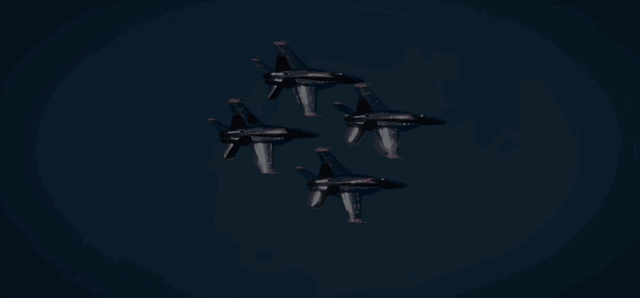
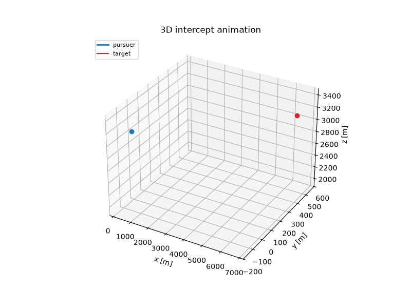

### Hi, I'm Vincenzo 👋

From Naples, studying business and computer science (AI) at IE University in Madrid. I build products end to end: mobile apps, web dashboards, and simulation and ML tooling for aerospace-flavoured problems. Currently a software engineer at Italtronik, shipping client projects in TypeScript and Node.

  
  
  
  
  
  
  
  
  
  
  
  

### Featured

<table>
  <tr>
    <td width="50%" valign="top">
      
       <a href="https://github.com/Vinvin00/AERIS"><b>AERIS</b></a>
       Detects aircraft in recorded video, tracks them and forecasts image-space trajectories. Kalman tracking, a COCO/HOTA metric harness and 179 tests. The demo is a synthetic fixture, and the repo states plainly what has and hasn't been measured.
    </td>
    <td width="50%" valign="top">
      
       <a href="https://github.com/Vinvin00/missile_guidance_sim"><b>Guidance Sim</b></a>
       A 3D pursuit simulation on 6-DOF flight dynamics. A learned policy hits 88.7% of 300 held-out evasive-target cases against 72.7% for classical proportional navigation.
    </td>
  </tr>
</table>

## Also built

- [**aero-spec-rag**](https://github.com/Vinvin00/aero-spec-rag): ask for an aerospace parameter, get cited JSON back, with out-of-bounds values rejected
- [**Weather Playlist**](https://github.com/Vinvin00/weather-spotify-playlist): a Spotify playlist that rebuilds itself hourly from the weather in Segovia
- [**Pitch Perfect**](https://github.com/Vinvin00/Pitch-Perfect): AI presentation coach scoring eye contact, posture, pace and filler words
- [**3D Portfolio**](https://github.com/Vinvin00/Portfolio): walk a character around a floating island to explore each section

## Stack

TypeScript · React · React Native · Node.js · Python · PyTorch · FastAPI · Firebase · C · C++ · Swift · Docker
